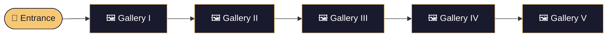

<div align="center">


<a href="https://github.com/YOUR_USERNAME/virtual-art-gallery">
  
</a>

<br/>

[](https://YOUR_USERNAME.github.io/virtual-art-gallery/)
[](https://threejs.org/)
[](https://vitejs.dev/)
[](https://pages.github.com/)


</div>

---

## 🏛️ About

**Atelier Museum** is a first-person digital museum built with **Three.js**. Walk through **five connected galleries** whose walls are hung with paintings from the local collection in `public/images` and `public/metadata.json`.

> *Step in, look around, and let the art come to you.*

<div align="center">

| 🖼️ **40** | 🚪 **5** | ⚡ **Lazy** | 🎮 **FPS** |
|:---:|:---:|:---:|:---:|
| Curated works | Connected galleries | Images load as you approach | First-person controls |

</div>

---

## ✨ Features

<table>
<tr>
<td width="50%" valign="top">

### 🎨 Immersive Galleries
Five connected rooms with a curated selection of 40 paintings, hung and lit like a real museum.

### 🔍 Look to Learn
Aim at any painting to reveal its **title** and **artist** (when available).

</td>
<td width="50%" valign="top">

### ⚡ Smart Loading
Artwork images **load as you approach** and are **resized in the browser** for faster rendering.

### 🕹️ Natural Controls
Smooth first-person movement with `W` `A` `S` `D` and mouse look, with instant pause and resume.

</td>
</tr>
</table>

---

## 🎮 Controls

<div align="center">

| Key / Action | What it does |
|:---:|:---|
| 🖱️ **Click "Enter the Gallery"** | Start the experience |
| <kbd>W</kbd> | Move forward |
| <kbd>A</kbd> | Strafe left |
| <kbd>S</kbd> | Move backward |
| <kbd>D</kbd> | Strafe right |
| 🖱️ **Mouse** | Look around |
| <kbd>Esc</kbd> | Pause and release the pointer |
| 🖱️ **Click the scene** | Resume exploring |
| 👁️ **Look at a painting** | See its title and artist |

</div>

```text
        ┌───┐
        │ W │
    ┌───┼───┼───┐
    │ A │ S │ D │      ← move      🖱️ ← look
    └───┴───┴───┘
```

---

## 🗺️ Gallery Layout



---

## 🚀 Run Locally

```bash
# 1. Clone the repository
git clone https://github.com/YOUR_USERNAME/virtual-art-gallery.git
cd virtual-art-gallery

# 2. Install dependencies
npm install

# 3. Start the dev server
npm run dev
```

Then open the local URL shown in your terminal and click **Enter the Gallery**.

### 📦 Production build

```bash
npm run build
```

<details>
<summary><b>🌐 Deploying to GitHub Pages</b></summary>

<br/>

The project is configured for GitHub Pages at `/virtual-art-gallery/`.

Publishing still depends on the **Pages workflow** and your **repository settings**:

1. Go to **Settings → Pages**
2. Set the source to **GitHub Actions**
3. Push to your main branch and let the workflow run

</details>

---

## 🗂️ Project Structure

```text
virtual-art-gallery/
├── public/
│   ├── images/            # 🖼️ Painting images
│   └── metadata.json      # 📝 Titles, artists and details
├── src/                   # 🧠 Three.js scene, controls and loaders
├── index.html
├── package.json
└── README.md
```

---

## 🧰 Tech Stack

<div align="center">


</div>

---

## 🤝 Contributing

Contributions, issues and feature requests are welcome!

1. 🍴 Fork the project
2. 🌿 Create your branch: `git checkout -b feature/amazing-idea`
3. 💾 Commit your changes: `git commit -m "Add amazing idea"`
4. 🚀 Push: `git push origin feature/amazing-idea`
5. 🔃 Open a Pull Request

---

<div align="center">

### ⭐ If you enjoyed the tour, leave a star!

<a href="https://github.com/YOUR_USERNAME/virtual-art-gallery/stargazers">
  
</a>


</div>
