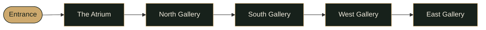

<div align="center">



<br />

### A museum you can walk into.
Explore a first-person 3D art museum, meet the collection up close, and open every exhibit for its story.

<br />


[](https://spiffy-elf-cca541.netlify.app/)
[](https://github.com/shivubuilds-mikasa/XR/raw/refs/heads/main/Atelier-Museum-Quest3.apk)
[](https://threejs.org/)
[](https://vite.dev/)

<br />

`WASD` TO WALK &nbsp;·&nbsp; `MOUSE` TO LOOK &nbsp;·&nbsp; `SPACE` TO DISCOVER

</div>

<br />

## Step inside

Atelier Museum turns a browser tab into a quiet, explorable exhibition. Wander through connected rooms, discover paintings and 3D objects along the walls, and open an exhibit when something catches your eye.

<div align="center">

| **5** connected rooms | **111** paintings | **4** 3D objects | **1** very dramatic Kabali moment |
|:---:|:---:|:---:|:---:|

</div>

<br />

## The experience

<table>
<tr>
<td width="50%" valign="top">

### 🏛️ Walk the galleries
Move through five connected rooms in a first-person 3D museum, with warm architectural details and a curated collection on the walls.

### 🖼️ Look closer
Focus on a painting or sculpture and press <kbd>Space</kbd> for a full-size view, title, and exhibit notes. Model details include an interactive 3D preview.

</td>
<td width="50%" valign="top">

### 🎭 Kabali Da, center stage
Open the Kabali portrait for a cinematic, slow-motion reveal. Its entrance reacts to the included theme track, with poster motion pulsing to the music.

### ⚡ Built to stay smooth
Artwork is loaded as it comes into view. The renderer adapts its workload when frame rates dip, helping the museum stay responsive across devices.

</td>
</tr>
</table>

### 🥽 Visit in VR
Open the [live museum](https://spiffy-elf-cca541.netlify.app/) in Meta Quest 3 Browser and choose **ENTER VR**. Or [download the Quest app APK](https://github.com/shivubuilds-mikasa/XR/raw/refs/heads/main/Atelier-Museum-Quest3.apk) and install it on your headset. Point a controller at an exhibit and squeeze its trigger to open the in-headset story panel; squeeze again to return. Use the left thumbstick to move and turn your head to look around.

<br />

## Take the tour

<div align="center">

| Input | Action |
|:---:|:---|
| **Click** | Enter the museum or resume after pausing |
| <kbd>W</kbd> <kbd>A</kbd> <kbd>S</kbd> <kbd>D</kbd> | Walk and strafe |
| **Mouse** | Look around |
| <kbd>Space</kbd> | Open the focused painting or model; press again to close |
| <kbd>Esc</kbd> | Close an exhibit, or pause and release the mouse |

</div>

<br />

## Gallery route



<br />

## Run it locally

You’ll need Node.js 20 or later.

```bash
git clone https://github.com/shivubuilds-mikasa/XR.git
cd XR
npm install
npm run dev
```

Open the local address printed by Vite, then click **Enter the Gallery**. To make a production build:

```bash
npm run build
npm run preview
```

The live site is hosted on Netlify: [spiffy-elf-cca541.netlify.app](https://spiffy-elf-cca541.netlify.app/).

<br />

## Under the frame

```text
XR/
├── public/
│   ├── audio/              Kabali theme music
│   ├── images/             Painting collection
│   ├── metadata.json       Artwork titles and descriptions
│   └── models/featured/    Optimized gallery objects
├── README/                 Animated project artwork
├── src/                    Three.js scene, controls, loading, and UI
├── quest-app/              Android wrapper project for Meta Quest
├── Atelier-Museum-Quest3.apk  Installable Quest release
├── index.html
└── vite.config.ts
```

<div align="center">

<br />

### Made for the joy of looking closer.

[**Open the live museum →**](https://spiffy-elf-cca541.netlify.app/)

<sub>Three.js · TypeScript · Vite · Netlify · Meta Quest 3</sub>

</div>
